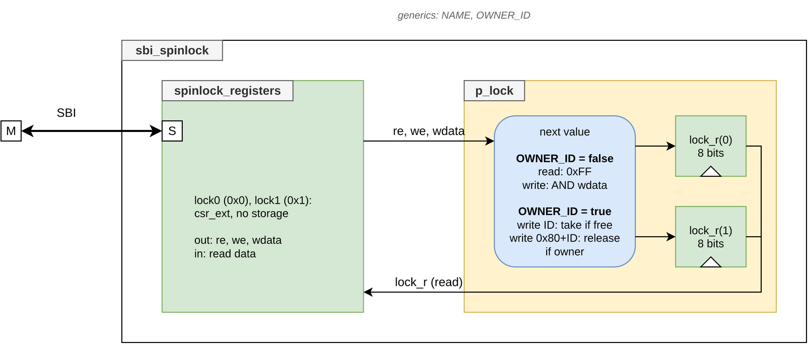
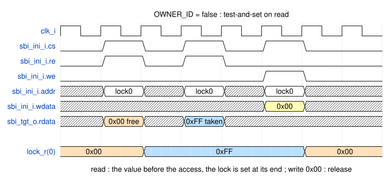

<!--
  README MODEL (common to every Asylum IP, keep the same headings)
  ----------------------------------------------------------------
  Regenerate from the sources, never from the previous README text alone:
    hdl/*.vhd (entities, generics, ports), hdl/csr/*.hjson (register map),
    <IP>.core (VLNV, targets, depends), mk/targets.txt, sim/, syn/, esw/.
  Sections, in this order:
    badges / title + one-line pitch / Overview / Features / Block Diagram /
    Getting Started / Hardware Interfaces / Configuration / Resources /
    Theory of Operation / Registers / Programmer's Guide /
    Design Verification / Dependencies and Related IPs / License
  Rules:
    - English, short and factual: every statement backed by the sources.
    - No VLNV line: the version badge shows it.
    - Badges: first line version, license; second line CI, lint, sim, syn.
    - Block diagram and FSM: pages Overview and FSM of doc/<NAME>.drawio, exported to
      doc/<NAME>-Overview.png and doc/<NAME>-FSM.png (make -C doc).
    - Timing diagrams: WaveDrom source doc/<NAME>-<what>.json, rendered
      doc/<NAME>-<what>.svg (make -C doc), shown as images.
    - No CPU named (OpenBlaze, PicoBlaze, RISC-V) outside the CPU and SoC IPs.
    - Registers: link to the generated hdl/csr/<X>_csr.md, never copy the tables.
    - Tables: Configuration = Name|Type|Default|Description,
      Hardware Interfaces = Name|Direction|Type|Description, grouped by interface.
    - A section with nothing to say is one line ("This IP has no
      software-visible registers."), never removed.
-->
[](https://github.com/deuskane/asylum-system-spinlock/tags)
[](LICENSE)

[](https://github.com/deuskane/asylum-system-spinlock/actions/workflows/ci.yml)
[](https://github.com/deuskane/asylum-system-spinlock/actions/workflows/ci.yml)
[](https://github.com/deuskane/asylum-system-spinlock/actions/workflows/ci.yml)
[](https://github.com/deuskane/asylum-system-spinlock/actions/workflows/ci.yml)

# Spinlock

**Two small hardware spinlocks in VHDL: test-and-set in a single bus read, or owner ID compare-and-set, two 8-bit registers.**

Part of the [Asylum project](https://github.com/deuskane/asylum-project), a collection of small IP cores, written to be read and learned from.

## Table of Contents

1. [Overview](#overview)
2. [Features](#features)
3. [Block Diagram](#block-diagram)
4. [Getting Started](#getting-started)
5. [Hardware Interfaces](#hardware-interfaces)
6. [Configuration](#configuration)
7. [Resources](#resources)
8. [Theory of Operation](#theory-of-operation)
9. [Registers](#registers)
10. [Programmer's Guide](#programmers-guide)
11. [Design Verification](#design-verification)
12. [Dependencies and Related IPs](#dependencies-and-related-ips)
13. [License](#license)

## Overview

Several software agents sharing a memory need a lock to enter a critical section one at a time. A lock built in memory needs an atomic read-modify-write instruction; this IP does the atomic part in hardware, on the SBI bus (the simple bus of Asylum), so any CPU can use it with plain 8-bit loads and stores.

It has two independent locks, `lock0` and `lock1`, one 8-bit register each. The generic `OWNER_ID` selects the protocol:

- `OWNER_ID = false` (default): **test-and-set on read**. A read returns the state of the lock and takes it in the same access: `0x00` means the lock was free and now belongs to the reader. A write of `0x00` releases it.
- `OWNER_ID = true`: **owner ID**. An agent writes its ID (`0x01` to `0x7F`) to take a free lock and writes `0x80 + ID` to release it; a read returns the owner and has no side effect.

## Features

- 2 independent locks: `lock0` at address `0x0`, `lock1` at address `0x1`
- `OWNER_ID = false`: acquire in one bus read (test-and-set), release by writing `0x00`
- `OWNER_ID = true`: acquire by writing an ID to a free lock, release by writing `0x80 + ID`, refused when ID is not the owner; reads without side effect (polling, debugger)
- Both locks free after reset, asynchronous reset
- Zero wait state: `sbi_tgt_o.ready` is always 1
- Instance name (`NAME`) in `sbi_tgt_o.info.name`
- Registers generated by regtool from [hdl/csr/spinlock.hjson](hdl/csr/spinlock.hjson)

## Block Diagram



## Getting Started

The cores of the Asylum IPs are published in the FuseSoC library [asylum-cores](https://github.com/deuskane/asylum-cores) (with the UVVM core used by the testbench):

```bash
pip install fusesoc
fusesoc library add https://github.com/deuskane/asylum-cores
fusesoc run --target sim_spinlock_acquire_release asylum:system:spinlock  # needs GHDL
```

To use the IP in your design, add `asylum:system:spinlock` to the `depend` list of your core and instantiate `sbi_spinlock` (library `asylum`):

```vhdl
library asylum;
use     asylum.sbi_pkg.all;
use     asylum.spinlock_pkg.all;

  ins_spinlock : sbi_spinlock
    generic map
    ( NAME      => "SPINLOCK0"
     ,OWNER_ID  => false
    )
    port map
    ( clk_i     => clk
     ,arst_b_i  => arst_b
     ,sbi_ini_i => sbi_ini       -- 1 address bit, 8-bit data
     ,sbi_tgt_o => sbi_tgt
    );
```

[PicoSoC](https://github.com/deuskane/asylum-soc-picosoc) is a complete example: it connects this IP to its SBI interconnect.

## Hardware Interfaces

Top-level entity: **`sbi_spinlock`** ([hdl/sbi_spinlock.vhd](hdl/sbi_spinlock.vhd)), component in `asylum.spinlock_pkg`.

### Clock and Reset

| Name | Direction | Type | Description |
|------|-----------|------|-------------|
| `clk_i` | in | std_logic | System clock, the only clock of the IP |
| `arst_b_i` | in | std_logic | Asynchronous reset, active low: releases both locks |

### Bus (SBI)

| Name | Direction | Type | Description |
|------|-----------|------|-------------|
| `sbi_ini_i` | in | sbi_ini_t | Request from the initiator (`cs`, `re`, `we`, `addr`, `wdata`); 1 address bit (`SPINLOCK_ADDR_WIDTH`), 8-bit data (`SPINLOCK_DATA_WIDTH`) |
| `sbi_tgt_o` | out | sbi_tgt_t | Response to the initiator (`ready`, `rdata`, `info`) |

## Configuration

Generics of `sbi_spinlock`:

| Name | Type | Default | Description |
|------|------|---------|-------------|
| `NAME` | string | `""` | Instance name, in `sbi_tgt_o.info.name` (`"spinlock"` when empty) |
| `OWNER_ID` | boolean | `false` | Lock protocol: `false` test-and-set on read, `true` owner ID (see [Theory of Operation](#theory-of-operation)) |

## Resources

Figures of the `syn_*` targets (`make nonreg_syn`, see [Targets](#targets)): [syn/sbi_spinlock_wrapper.vhd](syn/sbi_spinlock_wrapper.vhd) with the generics of each configuration, synthesized by Yosys and its GHDL plugin; the reports are in the build directory of each target.

| Configuration | LUT¹ | LUTRAM¹ | FF¹ | CARRY4¹ | MUXF7/F8¹ | BRAM¹ | DSP¹ | Area² (µm²) | kGE³ |
|---|---|---|---|---|---|---|---|---|---|
| `syn_default` (`OWNER_ID = false`) | 25 | 0 | 16 | 0 | 0 | 0 | 0 | 658.13 | 0.175 |
| `syn_owner` (`OWNER_ID = true`) | 35 | 0 | 16 | 0 | 12 | 0 | 0 | 982.19 | 0.262 |

¹ Xilinx Artix-7 (LUT6), Yosys 0.33 `synth_xilinx -flatten -noiopad -noclkbuf`, before place and route: every cell of the netlist is counted, Vivado may differ. Identical cells are merged as a vendor tool does (`opt_merge -share_all`): the inverters of an active-low reset net become one (the 16 lock flip-flops share one `INV` in both configurations); every remaining cell is counted, an `INV` as a `LUT1`. The IP has no memory: no LUTRAM, no BRAM. The 16 flip-flops are the two 8-bit lock registers.

² SkyWater sky130 `sky130_fd_sc_hd`, typical corner (tt, 25 °C, 1.80 V), Yosys 0.33 `synth` + `dfflibmap` + `abc -liberty`: standard-cell area only, no timing constraint, no buffering, clock tree or placement.

³ Area in thousands of NAND2 gate equivalents (`sky130_fd_sc_hd__nand2_1` = 3.7536 µm²).

## Theory of Operation

### Hierarchy

| File | Unit | Role |
|------|------|------|
| [hdl/sbi_spinlock.vhd](hdl/sbi_spinlock.vhd) | `sbi_spinlock` | Top level: register bank and the two lock registers with their protocol (process `p_lock`) |
| [hdl/spinlock_pkg.vhd](hdl/spinlock_pkg.vhd) | `spinlock_pkg` | Component of `sbi_spinlock` |
| [hdl/csr/spinlock_csr.vhd](hdl/csr/spinlock_csr.vhd) | `spinlock_registers` | Register bank generated by regtool: address decoding, two `csr_ext` registers |

The two registers of the bank are `ext` registers (`csr_ext`): they hold no value. On each access, the bank gives `sbi_spinlock` the read strobe `re`, the write strobe `we` and the write data, in the cycle of the access, and returns the lock register `lock_r` as read data. The lock registers and their next value are in `p_lock` of `sbi_spinlock`, reset to `0x00` (free).

### OWNER_ID = false: test-and-set on read

| Software access | Read data | Next value |
|-----------------|-----------|------------|
| Read | current value | `0xFF` |
| Write `wdata` | - | current value AND `wdata` (`0x00` releases) |
| None | - | unchanged |

The read data is the value before the access; the lock is set at the end of the access. One read therefore both tests and takes the lock: of two agents reading a free lock, the interconnect serves one first, it reads `0x00`, the other reads `0xFF`.



A write clears the bits written to 0 and never takes a lock: `0x0F` on a taken lock leaves `0x0F` (still taken, non-zero), the next read sets it back to `0xFF`. This is the `rsw0c` model of the regtool registers. A request with `re` and `we` both at 1 loads `wdata` (this case is not produced by the SBI initiators of the testbench and is not verified).

Limits of this mode: the lock has no owner. Any agent can release a lock it does not hold by writing `0x00`, and any read of a free lock takes it, also a diagnostic read (debugger memory dump): the lock then stays taken with no owner to release it. The SBI request carries no initiator identifier, so the hardware cannot check who accesses the lock.

### OWNER_ID = true: owner ID compare-and-set

Each agent uses its own ID, `0x01` to `0x7F`. The lock holds the ID of its owner, `0x00` when free:

| Software access | Read data | Next value |
|-----------------|-----------|------------|
| Read | owner ID (`0x00` = free) | unchanged |
| Write `ID` (`0x01` to `0x7F`) | - | `ID` if the lock is free, else unchanged |
| Write `0x80 + ID` | - | `0x00` if `ID` is the owner, else unchanged |
| Other writes (`0x00`, `0x80 + ID` of another agent, any value with the MSB set on a free lock) | - | unchanged |

The write is atomic (the interconnect serializes the initiators), so two agents cannot both take the lock: each one writes its ID, then reads the lock back to know whether it won. A release by an agent that is not the owner is ignored, and reads never modify the lock. The ID is written by software: this protects against a release by mistake, not against code that uses the ID of another agent. Software written for `OWNER_ID = false` (acquire by read) does not work in this mode.

## Registers

Two 8-bit registers (1 address bit): `lock0` (0x0) and `lock1` (0x1).

- Register documentation: **[hdl/csr/spinlock_csr.md](hdl/csr/spinlock_csr.md)**
- C header: [hdl/csr/spinlock_csr.h](hdl/csr/spinlock_csr.h)
- Source: [hdl/csr/spinlock.hjson](hdl/csr/spinlock.hjson) (regtool)

## Programmer's Guide

1. Choose a lock per shared resource (`SPINLOCK_LOCK0` or `SPINLOCK_LOCK1`) and use it with the protocol of the `OWNER_ID` of the instance.
2. `OWNER_ID = false`: read the lock until it returns `0x00` (taken by this read), run the critical section, write `0x00`. Only the owner writes `0x00`; never read a lock you do not want to take.
3. `OWNER_ID = true`: give each agent its own ID (`0x01` to `0x7F`). Write the ID and read the lock back until it returns the ID, run the critical section, write `0x80 | ID`.

### Example: acquire and release

The registers are 8 bits wide, at consecutive byte addresses from the base address of the IP (`0x40000000` is an example, use the address map of your SoC).

```c
#include <stdint.h>
#include "spinlock_csr.h"

#define SPINLOCK_BASE ((uintptr_t)0x40000000u)   // example base address

static inline void reg_wr(uint32_t offset, uint8_t data)
{
  *(volatile uint8_t *)(SPINLOCK_BASE + offset) = data;
}

static inline uint8_t reg_rd(uint32_t offset)
{
  return *(volatile uint8_t *)(SPINLOCK_BASE + offset);
}

// OWNER_ID = false : test-and-set on read
void lock_tas(uint32_t lock)               // lock : SPINLOCK_LOCK0 or SPINLOCK_LOCK1
{
  while (reg_rd(lock) != 0x00)             // 0x00 : was free, now taken by this read
    ;
}

void unlock_tas(uint32_t lock)
{
  reg_wr(lock, 0x00);                      // release
}

// OWNER_ID = true : owner ID, my_id from 0x01 to 0x7F
void lock_owner(uint32_t lock, uint8_t my_id)
{
  do {
    reg_wr(lock, my_id);                   // taken only if free
  } while (reg_rd(lock) != my_id);         // read back : owner ?
}

void unlock_owner(uint32_t lock, uint8_t my_id)
{
  reg_wr(lock, 0x80 | my_id);              // ignored if my_id is not the owner
}

void example(void)
{
  lock_tas(SPINLOCK_LOCK0);
  /* critical section */
  unlock_tas(SPINLOCK_LOCK0);
}
```

## Design Verification

### Testbench

| File | DUT | Description |
|------|-----|-------------|
| [sim/spinlock/tb_spinlock.vhd](sim/spinlock/tb_spinlock.vhd) | `sbi_spinlock` | Self-checking UVVM testbench with the SBI BFM, generics `TESTS_LIST` (scenarios, see below) and `OWNER_ID`: every scenario checks the protocol of the `OWNER_ID` of the DUT. Every access must complete without wait state (`max_wait_cycles = 0`). Helpers in [tb_spinlock_bfm_pkg](sim/spinlock/tb_spinlock_bfm_pkg.vhd), scenarios in `tb_spinlock_<name>_pkg`, names and dispatch in [tb_spinlock_tests_pkg](sim/spinlock/tb_spinlock_tests_pkg.vhd) |

### Scenarios (`TESTS_LIST`)

The scenarios are chosen at run time with the generic `TESTS_LIST`: names separated by `,` without space (`acquire_release,independent,acquire_release`), a name may be repeated. The sequencer first checks every name (an unknown name is a `TB_ERROR` before any scenario runs), then for each scenario drives a reset pulse with the bus inactive, logs `TEST <i>/<N> : <name>` and runs it: each scenario starts from reset. The empty list (default) only compiles and elaborates the testbench. The list is parsed and its names checked with `list_length` / `list_item` / `list_contains` of `asylum.string_pkg` (`asylum:utils:pkg` >= 1.10.0).

Checks counted as the `=> OK` lines of the log, for each value of `OWNER_ID`:

| Name | Checks (`false` / `true`) | Description |
|------|---------------------------|-------------|
| `reset_values` | 5 / 5 | `NAME` in `sbi_tgt_o.info.name`; both locks free after reset. `false`: the first read returns `0x00`, the second `0xFF`; `true`: two reads return `0x00` (no side effect) |
| `acquire_release` | 18 / 54 | Three times on each lock. `false`: read `0x00` (taken), `0xFF`, `0xFF`, write `0x00`. `true`: acquire by ID `0x05`; refused: acquire by `0x07`, `0x05` again by its owner, release by `0x87` and by `0xC5` (ID `0x45`, differs in bit 6), writes `0x00` and `0xFF`; release by `0x85` |
| `independent` | 7 / 6 | An access to a lock never changes the other one. `true`: two owners, a release with the ID of the owner of the other lock is refused |
| `write_values` | 10 / 10 | `false`: non-zero writes keep a free lock free, `0xFF` keeps a taken lock taken, `0x0F` on a taken lock reads `0x0F` then `0xFF`, `0xF0` then `0x0F` release it. `true`: `0x85`, `0x80`, `0x00` never take a free lock; IDs `0x7F` and `0x01`, `0xFF` releases `0x7F` |
| `async_reset` | 12 / 8 | Both locks taken, a reset pulse releases them; taken again, a reset pulse between a falling and the next rising edge of the clock (no clock edge during the reset) releases them too |

### Targets

| Target | Toplevel | Description |
|--------|----------|-------------|
| `default` | `sbi_spinlock` | HDL fileset + CSR generation (not a simulation) |
| `sim_spinlock` | `tb_spinlock` | Reference configuration (`OWNER_ID = false`): build and elaboration only (`TESTS_LIST` empty), base of the scenario targets |
| `sim_spinlock_<name>` | `tb_spinlock` | One target per scenario, `OWNER_ID = false`: `sim_spinlock_reset_values`, `_acquire_release`, `_independent`, `_write_values`, `_async_reset` (52 checks in all) |
| `sim_spinlock_owner` | `tb_spinlock` | `OWNER_ID = true`, every scenario (83 checks) |
| `lint_ghdl` | `asylum.sbi_spinlock_wrapper` | GHDL `-Wall` analysis and elaboration of [syn/sbi_spinlock_wrapper.vhd](syn/sbi_spinlock_wrapper.vhd) (`sbi_spinlock` with flat SBI ports) |
| `lint_ghdl_synth_<config>` | `asylum.sbi_spinlock_wrapper` | `ghdl --synth` check (no latch, synthesizable) for 2 configurations: `default`, `owner` (`OWNER_ID = true`) |
| `syn_<config>` | `asylum.sbi_spinlock_wrapper` | Synthesis with Yosys, Artix-7 and sky130 (see [Resources](#resources)), same 2 configurations as `lint_ghdl_synth_<config>`: `syn_default`, `syn_owner` |

The reference configuration of the testbench has a build-only base target and one target per scenario: one CI job per scenario, a failure is isolated. The other configuration has one target that runs its whole list: the `TEST <i>/<N>` header names a failing scenario. FuseSoC replaces the `parameters` list of an inherited target, so each target repeats the generics of its configuration.

Every `sim_*`, `lint_*` and `syn_*` target is a job of the [GitHub CI](https://github.com/deuskane/asylum-system-spinlock/actions/workflows/ci.yml), run in the [asylum-env](https://github.com/deuskane/asylum-ci) image (GHDL, FuseSoC, UVVM, Yosys). The `sim`, `lint` and `syn` badges count the passed and failed targets of the last run on `main`.

### How to Run

From a clone of [asylum-project](https://github.com/deuskane/asylum-project) (GHDL and FuseSoC installed, or in the asylum-env image):

```bash
make help                        # variables, rules and targets
make sim_spinlock_write_values   # one scenario, log in log/
make sim_spinlock_owner          # every scenario, OWNER_ID = true
make nonreg_sim                  # every sim_* target
make nonreg_lint                 # every lint_* target
make nonreg_syn                  # every syn_* target (Yosys, figures of Resources)
```

To run a list of scenarios, build the testbench once, then run the list without recompiling with FuseSoC (same `--build-root` and `--no-export` as the Makefile, so that the build of the target is reused; any generic of the target can be overridden after the VLNV):

```bash
make sim_spinlock                # build and elaboration (TESTS_LIST empty)
fusesoc --cores-root . run --build-root build --no-export --run --target sim_spinlock asylum:system:spinlock:1.0.2 --TESTS_LIST=acquire_release,async_reset --OWNER_ID=true
```

To add a scenario: a `tb_spinlock_<name>_pkg` with its procedure `run` in [sim/spinlock](sim/spinlock) and in the `sim` fileset, its name in `C_TESTS` and its case in `run_test` of `tb_spinlock_tests_pkg`, a `sim_spinlock_<name>` target and the name in the `TESTS_LIST` of `sim_spinlock_owner` in [spinlock.core](spinlock.core), then `make mk/targets.txt` and `make ci_generate`.

Outside the CI, GHDL writes a waveform `dut.fst`.

## Dependencies and Related IPs

| Core | Repository | Purpose |
|------|------------|---------|
| `asylum:utils:generators` | [asylum-utils-generators](https://github.com/deuskane/asylum-utils-generators) | regtool (register generator) and the CSR building blocks (`csr_ext`) |
| `asylum:utils:pkg` | [asylum-utils-pkg](https://github.com/deuskane/asylum-utils-pkg) | Common packages (`sbi_pkg`, ...); the testbench needs >= 1.10.0 (`string_pkg` lists of `TESTS_LIST`) |
| `asylum:utils:ghdl_synth` | [asylum-utils-generators](https://github.com/deuskane/asylum-utils-generators) | `ghdl --synth` check of the `lint_ghdl_synth_*` targets |
| `asylum:utils:yosys_synth` | [asylum-utils-generators](https://github.com/deuskane/asylum-utils-generators) | Yosys synthesis of the `syn_*` targets (Artix-7 and sky130) |
| `bitvis:verification:uvvm` | [UVVM](https://github.com/UVVM/UVVM) | Verification library and SBI BFM |

Used by [asylum-soc-picosoc](https://github.com/deuskane/asylum-soc-picosoc). Other system IPs of Asylum: [mailbox](https://github.com/deuskane/asylum-system-mailbox), [GIC](https://github.com/deuskane/asylum-system-gic). All the IPs: [asylum-project](https://github.com/deuskane/asylum-project).

## License

Apache License 2.0, see [LICENSE](LICENSE).
